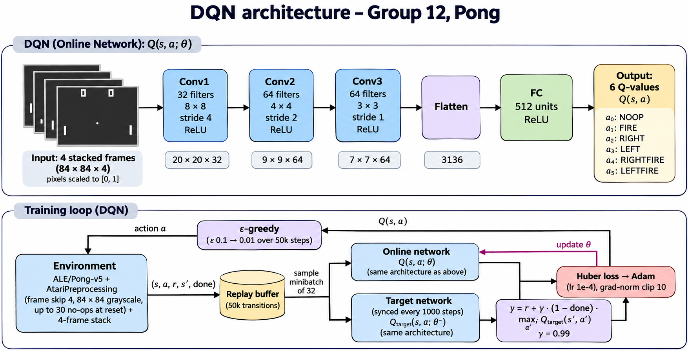
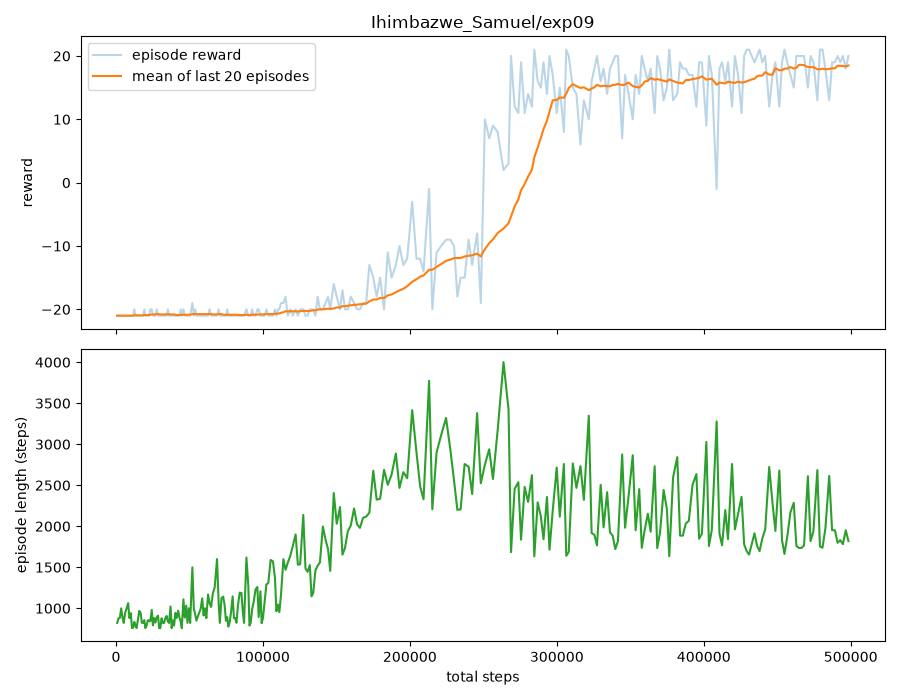

# Deep Q-Learning on Atari Pong (Group 12)

A Deep Q-Network (DQN) trained from scratch on `ALE/Pong-v5` with PyTorch and Gymnasium. Each member ran 10 hyperparameter experiments, and the best model is in `dqn_model.pth`.

Members: Ihimbazwe Samuel, Nkusi Dan

## Repository layout

| Path | What it is |
|---|---|
| `train.py` | Trains a DQN agent and saves the model, a per-episode log and a reward plot |
| `play.py` | Loads a trained model and plays Pong greedily (on screen, or recorded to mp4) |
| `evaluate.py` | Plays a few greedy games without a window and saves the scores to `eval.json` |
| `dqn_model.pth` | The group's best model (Dan's experiment 8) |
| `notebooks/kaggle_training.ipynb` | Samuel's notebook for running his experiments on a Kaggle GPU |
| `notebooks/kaggle_experiments.ipynb` | Dan's notebook. It trains his 10 experiments on a Kaggle GPU and scores each model with `evaluate.py` |
| `Ihimbazwe_Samuel/expXX/`, `Nkusi_Dan/expXX/` | One folder per run: `config.json`, `dqn_model.pth`, `log.csv`, `plot.png` (Dan's runs also have `eval.json` with the greedy scores) |
| `*_Hyperparameter_experiment_results.md` | Each member's full results table and analysis |

## Setup

The project uses [uv](https://docs.astral.sh/uv/) and Python 3.11.

```bash
uv sync
```

This installs PyTorch, Gymnasium with the Atari ROMs (`ale-py`), NumPy, OpenCV, Matplotlib and MoviePy, at the versions pinned in `uv.lock`.

## Training

```bash
uv run python train.py --total-steps 500000 --out-dir runs/my_run
```

All hyperparameters are command-line flags:

| Flag | Default | Meaning |
|---|---|---|
| `--lr` | 0.0001 | Adam learning rate |
| `--gamma` | 0.99 | Discount factor |
| `--batch-size` | 32 | Transitions per gradient update |
| `--eps-start` | 1.0 | Epsilon at the start of training |
| `--eps-end` | 0.05 | Epsilon after the decay |
| `--eps-decay` | 100000 | Steps over which epsilon falls linearly from start to end |
| `--total-steps` | 200000 | Environment steps to train for (all of our experiments used 500000) |
| `--buffer-size` | 50000 | Replay buffer capacity |
| `--learning-starts` | 10000 | Random steps collected before learning begins |
| `--train-freq` | 4 | One gradient update every N steps |
| `--target-update` | 1000 | Copy the online network into the target network every N steps |
| `--seed` | 42 | Random seed |
| `--out-dir` | `runs/default` | Where the model, log and plot are saved |

A 500k-step run takes about 20 minutes on a Kaggle T4 GPU. On a laptop CPU it runs at about 25 steps/s, which is why we trained on Kaggle (see the two notebooks).

## Playing

```bash
uv run python play.py                       # opens a window and plays 3 games with dqn_model.pth
uv run python play.py --model Nkusi_Dan/exp08/dqn_model.pth --episodes 5
uv run python play.py --record              # saves mp4s to videos/ instead of opening a window
```

`play.py` always picks the action with the highest Q-value (no epsilon). It imports the environment and the network from `train.py`, so the preprocessing is exactly the same as in training.

To score a model without opening a window (this is how Dan's `eval.json` files were made):

```bash
uv run python evaluate.py --model Nkusi_Dan/exp08/dqn_model.pth --episodes 5 --out eval.json
```

## How the agent works



**Environment and preprocessing:**
- `ALE/Pong-v5` with sticky actions turned off.
- `AtariPreprocessing`: frame skip 4, 84×84 grayscale, and up to 30 random no-ops at reset.
- The last 4 frames are stacked so the network can see which way the ball is moving.

**Network:** the Nature-DQN CNN.
- Three conv layers: 32 filters 8×8 stride 4, 64 filters 4×4 stride 2, 64 filters 3×3 stride 1.
- A 512-unit fully connected layer, then one output per action (6 actions).
- Pixels are scaled to [0, 1] inside the network.

**Learning:**
- Experience replay: a uint8 buffer of 50k transitions, sampled uniformly.
- A separate target network, synced every 1000 steps.
- Huber loss on the Bellman target, gradient-norm clipping at 10, and the Adam optimiser.
- Only real episode ends (`terminated`) zero out the future value. A time-limit cut (`truncated`) does not.

## Hyperparameter experiments

Samuel tuned exploration (epsilon start, end and decay) with learning rate 0.0001, gamma 0.99 and batch size 32 fixed. Dan then took Samuel's best exploration setting (epsilon 0.1 to 0.01 over 50k steps) and tuned learning rate, gamma and batch size. Everything else in the training table above stayed fixed, and every run was 500k steps with seed 42.

Below is a summary. The full tables, with the observed behaviour of each run and each member's analysis, are in [Ihimbazwe_Samuel_Hyperparameter_experiment_results.md](Ihimbazwe_Samuel_Hyperparameter_experiment_results.md) and [Nkusi_Dan_Hyperparameter_experiment_results.md](Nkusi_Dan_Hyperparameter_experiment_results.md).

"Train" is the mean reward of the last 20 training episodes. "Greedy" is the mean score with epsilon = 0: Samuel played 3 games, and Dan played 5 games from different reset seeds. Pong scores run from -21 to +21.

### Ihimbazwe Samuel

| Exp | ε start | ε end | ε decay | Train | Greedy |
|---|---|---|---|---|---|
| 1 | 1.0 | 0.05 | 100k | -13.6 | -11.3 |
| 2 | 1.0 | 0.01 | 100k | -18.7 | -13.3 |
| 3 | 1.0 | 0.10 | 100k | -16.3 | -17.3 |
| 4 | 1.0 | 0.20 | 100k | -13.3 | -8.0 |
| 5 | 1.0 | 0.05 | 25k | -13.7 | -15.0 |
| 6 | 1.0 | 0.05 | 250k | -16.4 | -13.7 |
| 7 | 1.0 | 0.05 | 400k | -13.8 | -5.7 |
| 8 | 0.5 | 0.05 | 100k | -16.4 | -18.3 |
| **9** | **0.1** | **0.01** | **50k** | **+18.5** | **+20.0** |
| 10 | 0.01 | 0.01 | 50k | -10.6 | -3.3 |

### Nkusi Dan

All of Dan's runs used epsilon 0.1 to 0.01 over 50k steps.

| Exp | Learning rate | Gamma | Batch size | Train | Greedy |
|---|---|---|---|---|---|
| 1 | 0.0001 | 0.99 | 32 | -4.1 | +13.0 |
| 2 | 0.0005 | 0.99 | 32 | -21.0 | -21.0 |
| 3 | 0.001 | 0.99 | 32 | -21.0 | -21.0 |
| 4 | 0.000025 | 0.99 | 32 | -18.3 | -15.0 |
| 5 | 0.0001 | 0.95 | 32 | -16.1 | -15.0 |
| 6 | 0.0001 | 0.9 | 32 | -11.9 | -14.4 |
| 7 | 0.0001 | 0.999 | 32 | -2.5 | -3.6 |
| **8** | **0.0001** | **0.99** | **64** | **+16.9** | **+20.2** |
| 9 | 0.0001 | 0.99 | 128 | +18.7 | +14.8 |
| 10 | 0.0005 | 0.99 | 64 | -21.0 | -21.0 |

### What we found

- **A low starting epsilon was the biggest win in Samuel's runs.** His experiment 9 (epsilon 0.1 to 0.01) was the only one of his runs that learned to win consistently: +18.5 in training, +20 greedy. Every run that started at 1.0 was still losing at 500k steps. Going even lower (0.01 the whole time, experiment 10) was too little: it learned to return the ball but not to win points. Runs that started low also began improving earlier, because in Pong the agent gets a reward at the end of every point and does not need many random actions to find one.
- **The learning rate has to stay small.** In Dan's runs, 0.0005 and 0.001 never left -21, even with batch size 64. 0.000025 was too slow and only started improving around 300k steps. 0.0001 was the only value that worked.
- **A bigger batch helped the most in Dan's runs.** Batch sizes 64 and 128 started learning earlier (75k to 100k steps) and finished at +16.9 and +18.7 in training, far ahead of the batch-32 baseline. Dan's experiment 8 (batch 64) had the best greedy score of all runs, 20.2.
- **Gamma 0.99 was best.** Lowering it to 0.95 or 0.9 hurt clearly. Raising it to 0.999 was about the same as the baseline in training but worse greedy.
- **One seed is not enough to rank runs.** Dan's experiment 1 used exactly the same settings and seed as Samuel's experiment 9, but finished at -4.1 in training against +18.5, because GPU training is not bit-for-bit reproducible. Even large gaps between two single runs can be noise. The clearest results are the ones that repeat: the high learning rates all failing, and both big-batch runs winning.
- **The greedy scores cover fewer games than they look.** With sticky actions off, Pong is almost deterministic, so a greedy agent often plays the same game again. In Dan's evaluations, games 2 to 5 were usually identical.

### Final model

`dqn_model.pth` is Samuel's experiment 9: learning rate 0.0001, gamma 0.99, batch size 32, epsilon 0.1 to 0.01 over 50k steps, 500k steps in total. It scored +20 in each of its 3 greedy games. Dan's experiment 8 (the same settings with batch size 64) scored about the same, 20.2 over 5 greedy games.

Training curve of the final model (Samuel's experiment 9):



### Gameplay video

[Watch the agent play Pong](https://canva.link/7y4nyopeptulal2), or download the recording from the repo: [docs/gameplay.mp4](docs/gameplay.mp4)

The video shows the final model (Samuel's experiment 9) playing one greedy game, recorded with `uv run python play.py --record --episodes 1`.
