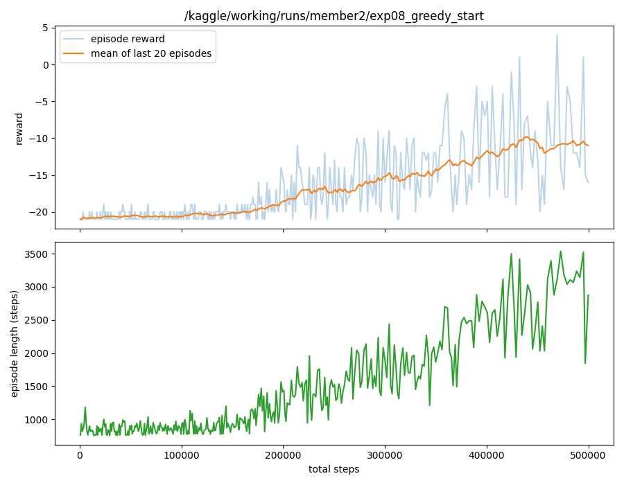
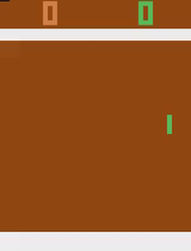

# Deep Q-Learning on Atari Pong (Group 12)

## Project introduction

A Deep Q-Network (DQN) trained from scratch on `ALE/Pong-v5` with PyTorch and Gymnasium. The network, replay buffer, epsilon-greedy exploration and training loop are all written by us in `train.py`, without any RL library. Each member ran 10 hyperparameter experiments, and the best model is in `dqn_model.pth`. Played greedily, it wins Pong about 21-0.

## Group members

| Member | Main work |
|---|---|
| Ihimbazwe Samuel | DQN training algorithm (replay buffer, epsilon-greedy, Bellman target, loss, target network), `play.py`, Kaggle training notebook, epsilon experiments |
| Nkusi Orrie Dan | Environment and CNN architecture, learning rate / gamma / batch size experiments, `evaluate.py`, README |

We worked on most parts together. The full breakdown and our meeting log are in [Task allocation sheet.pdf](Task%20allocation%20sheet.pdf).

## Selected Atari environment

`ALE/Pong-v5`. The agent controls the green paddle on the right and plays against the built-in computer opponent on the left. A point is scored when the ball gets past the other player's paddle, and the game ends when one side reaches 21. The reward is +1 for every point the agent wins and -1 for every point it loses, so the total reward of an episode is between -21 (lost every point) and +21 (won every point). There are 6 actions: NOOP, FIRE, RIGHT, LEFT, RIGHTFIRE and LEFTFIRE (in Pong, RIGHT and LEFT move the paddle up and down).

Preprocessing:
- Sticky actions turned off, so the chosen action is always executed.
- `AtariPreprocessing`: frame skip 4, 84×84 grayscale, and up to 30 random no-ops at reset.
- The last 4 frames are stacked so the network can see which way the ball is moving.

## Repository layout

| Path | What it is |
|---|---|
| `train.py` | Trains a DQN agent and saves the model, a per-episode log and a reward plot |
| `play.py` | Loads a trained model and plays Pong greedily (on screen, or recorded to mp4) |
| `evaluate.py` | Plays a few greedy games without a window and saves the scores to `eval.json` |
| `dqn_model.pth` | The group's best model (Dan's experiment 8) |
| `notebooks/kaggle_training.ipynb` | Samuel's notebook for running his experiments on a Kaggle GPU |
| `notebooks/kaggle_experiments.ipynb` | Dan's notebook. It trains his 10 experiments on a Kaggle GPU and scores each model with `evaluate.py` |
| `Ihimbazwe_Samuel/expXX/`, `Nkusi_Dan/expXX/` | One folder per run: `config.json`, `dqn_model.pth`, `log.csv`, `plot.png` (Dan's runs also have `eval.json` with the greedy scores) |
| `*_Hyperparameter_experiment_results.md` | Each member's full results table and analysis |

## Setup

The project uses [uv](https://docs.astral.sh/uv/) and Python 3.11.

```bash
uv sync
```

This installs PyTorch, Gymnasium with the Atari ROMs (`ale-py`), NumPy, OpenCV, Matplotlib and MoviePy, at the versions pinned in `uv.lock`.

## Training

```bash
uv run python train.py --total-steps 500000 --out-dir runs/my_run
```

All hyperparameters are command-line flags:

| Flag | Default | Meaning |
|---|---|---|
| `--lr` | 0.0001 | Adam learning rate |
| `--gamma` | 0.99 | Discount factor |
| `--batch-size` | 32 | Transitions per gradient update |
| `--eps-start` | 1.0 | Epsilon at the start of training |
| `--eps-end` | 0.05 | Epsilon after the decay |
| `--eps-decay` | 100000 | Steps over which epsilon falls linearly from start to end |
| `--total-steps` | 200000 | Environment steps to train for (all of our experiments used 500000) |
| `--buffer-size` | 50000 | Replay buffer capacity |
| `--learning-starts` | 10000 | Random steps collected before learning begins |
| `--train-freq` | 4 | One gradient update every N steps |
| `--target-update` | 1000 | Copy the online network into the target network every N steps |
| `--seed` | 42 | Random seed |
| `--out-dir` | `runs/default` | Where the model, log and plot are saved |

A 500k-step run takes about 20 minutes on a Kaggle T4 GPU. On a laptop CPU it runs at about 25 steps/s, which is why we trained on Kaggle (see the two notebooks).

## Playing

```bash
uv run python play.py                       # opens a window and plays 3 games with dqn_model.pth
uv run python play.py --model Nkusi_Dan/exp08/dqn_model.pth --episodes 5
uv run python play.py --record              # saves mp4s to videos/ instead of opening a window
```

`play.py` always picks the action with the highest Q-value (no epsilon). It imports the environment and the network from `train.py`, so the preprocessing is exactly the same as in training.

To score a model without opening a window (this is how Dan's `eval.json` files were made):

```bash
uv run python evaluate.py --model Nkusi_Dan/exp08/dqn_model.pth --episodes 5 --out eval.json
```

## DQN architecture


**Network (`QNetwork` in `train.py`):** the Nature-DQN CNN.
- Input: 4 stacked 84×84 grayscale frames, with pixels scaled to [0, 1] inside the network.
- Three conv layers: 32 filters 8×8 stride 4 (→ 32×20×20), 64 filters 4×4 stride 2 (→ 64×9×9), 64 filters 3×3 stride 1 (→ 64×7×7), each followed by ReLU.
- Flatten (3136 values), a 512-unit fully connected layer with ReLU, then one output per action: 6 Q-values, one for each action.

There are two copies of this network. The online network is the one being trained and picks the actions. The target network has the same architecture and is only used to compute the Bellman targets. Its weights are a copy of the online network's, refreshed every 1000 steps.

## Training process

Every environment step in `train.py` does the following:

1. **Pick an action (epsilon-greedy).** With probability epsilon take a random action (exploration), otherwise take the action with the highest Q-value from the online network (exploitation). Epsilon decreases linearly from `--eps-start` to `--eps-end` over `--eps-decay` steps, then stays at the end value.
2. **Act and store.** Play the action, then store `(state, action, reward, next_state, done)` in the replay buffer (50k transitions, oldest overwritten first). `done` is only true when the game really ended (`terminated`). A time-limit cut (`truncated`) doesn't count, because the game could have continued.
3. **Sample a batch.** After the first 10k steps, every 4 steps a random batch is drawn from the buffer. Sampling randomly instead of using the last few steps in order breaks the correlation between consecutive frames, which makes training much more stable.
4. **Predict Q-values.** The online network predicts Q(s, a) for the actions that were actually taken.
5. **Compute the Bellman target.** The target network computes `y = r + gamma * max_a' Q_target(s', a') * (1 - done)`. If the episode ended there is no future reward, so only `r` is left. Using the frozen target network means the target doesn't move every time the online network updates.
6. **Loss and update.** Huber loss between Q(s, a) and y, backpropagation, gradient-norm clipping at 10, then an Adam step on the online network. Huber loss acts like squared error for small errors but grows linearly for large ones, so a few bad targets don't blow up the gradients.
7. **Sync the target network.** Every 1000 steps the online weights are copied into the target network.
8. **Log the episode.** When a game ends, its length, the total step count, the reward and epsilon are written to `log.csv`. At the end of training the model is saved as `dqn_model.pth` and `plot.png` shows the reward and episode length curves.

## Hyperparameter experiments

Samuel tuned exploration (epsilon start, end and decay) with learning rate 0.0001, gamma 0.99 and batch size 32 fixed. Dan then took Samuel's best exploration setting (epsilon 0.1 to 0.01 over 50k steps) and tuned learning rate, gamma and batch size. Everything else in the training table above stayed fixed, and every run was 500k steps with seed 42.

Below is a summary. The full tables, with the observed behaviour of each run and each member's analysis, are in [Ihimbazwe_Samuel_Hyperparameter_experiment_results.md](Ihimbazwe_Samuel_Hyperparameter_experiment_results.md) and [Nkusi_Dan_Hyperparameter_experiment_results.md](Nkusi_Dan_Hyperparameter_experiment_results.md).

"Train" is the mean reward of the last 20 training episodes. "Greedy" is the mean score with epsilon = 0: Samuel played 3 games, and Dan played 5 games from different reset seeds. Pong scores run from -21 to +21.

### Ihimbazwe Samuel

| Exp | ε start | ε end | ε decay | Train | Greedy |
|---|---|---|---|---|---|
| 1 | 1.0 | 0.05 | 100k | -13.6 | -11.3 |
| 2 | 1.0 | 0.01 | 100k | -18.7 | -13.3 |
| 3 | 1.0 | 0.10 | 100k | -16.3 | -17.3 |
| 4 | 1.0 | 0.20 | 100k | -13.3 | -8.0 |
| 5 | 1.0 | 0.05 | 25k | -13.7 | -15.0 |
| 6 | 1.0 | 0.05 | 250k | -16.4 | -13.7 |
| 7 | 1.0 | 0.05 | 400k | -13.8 | -5.7 |
| 8 | 0.5 | 0.05 | 100k | -16.4 | -18.3 |
| **9** | **0.1** | **0.01** | **50k** | **+18.5** | **+20.0** |
| 10 | 0.01 | 0.01 | 50k | -10.6 | -3.3 |

### Nkusi Orrie Dan

All of Dan's runs used epsilon 0.1 to 0.01 over 50k steps.

| Exp | Learning rate | Gamma | Batch size | Train | Greedy |
|---|---|---|---|---|---|
| 1 | 0.0001 | 0.99 | 32 | -4.1 | +13.0 |
| 2 | 0.0005 | 0.99 | 32 | -21.0 | -21.0 |
| 3 | 0.001 | 0.99 | 32 | -21.0 | -21.0 |
| 4 | 0.000025 | 0.99 | 32 | -18.3 | -15.0 |
| 5 | 0.0001 | 0.95 | 32 | -16.1 | -15.0 |
| 6 | 0.0001 | 0.9 | 32 | -11.9 | -14.4 |
| 7 | 0.0001 | 0.999 | 32 | -2.5 | -3.6 |
| **8** | **0.0001** | **0.99** | **64** | **+16.9** | **+20.2** |
| 9 | 0.0001 | 0.99 | 128 | +18.7 | +14.8 |
| 10 | 0.0005 | 0.99 | 64 | -21.0 | -21.0 |

### What we found

- **A low starting epsilon was the biggest win in Samuel's runs.** His experiment 9 (epsilon 0.1 to 0.01) was the only one of his runs that learned to win consistently: +18.5 in training, +20 greedy. Every run that started at 1.0 was still losing at 500k steps. Going even lower (0.01 the whole time, experiment 10) was too little: it learned to return the ball but not to win points. Runs that started low also began improving earlier, because in Pong the agent gets a reward at the end of every point and does not need many random actions to find one.
- **The learning rate has to stay small.** In Dan's runs, 0.0005 and 0.001 never left -21, even with batch size 64. 0.000025 was too slow and only started improving around 300k steps. 0.0001 was the only value that worked.
- **A bigger batch helped the most in Dan's runs.** Batch sizes 64 and 128 started learning earlier (75k to 100k steps) and finished at +16.9 and +18.7 in training, far ahead of the batch-32 baseline. Dan's experiment 8 (batch 64) had the best greedy score of all runs, 20.2.
- **Gamma 0.99 was best.** Lowering it to 0.95 or 0.9 hurt clearly. Raising it to 0.999 was about the same as the baseline in training but worse greedy.
- **One seed is not enough to rank runs.** Dan's experiment 1 used exactly the same settings and seed as Samuel's experiment 9, but finished at -4.1 in training against +18.5, because GPU training is not bit-for-bit reproducible. Even large gaps between two single runs can be noise. The clearest results are the ones that repeat: the high learning rates all failing, and both big-batch runs winning.
- **The greedy scores cover fewer games than they look.** With sticky actions off, Pong is almost deterministic, so a greedy agent often plays the same game again. In Dan's evaluations, games 2 to 5 were usually identical.

### Final model

`dqn_model.pth` is Dan's experiment 8: learning rate 0.0001, gamma 0.99, batch size 64, epsilon 0.1 to 0.01 over 50k steps, 500k steps in total. It combines Samuel's best exploration setting with Dan's best batch size.

To pick it we played the three strongest models greedily on the same starting seeds:

| Model | Greedy games | Mean | Worst game | Stuck games |
|---|---|---|---|---|
| Dan's experiment 8 (batch 64) | 28 | +20.1 | +20 | 0 |
| Samuel's experiment 9 (batch 32) | 28 | +18.9 | +15 | 0 |
| Samuel's experiment 9 settings, seed 7, 1M steps | 8 | +16.8 | -1 | 1 |

The 1M-step run is a rerun of Samuel's experiment 9 with a different seed, to check that result wasn't luck (it also learned to win, +16.6 in training). But in one greedy game it got stuck in an endless rally until the time limit cut the game at about 27,000 steps. With epsilon = 0 the agent is fully deterministic, so once it falls into a loop nothing breaks it. Dan's experiment 8 never did this and won every game 20-1 or better, so it is the one used for the demo. The rerun is kept in `Ihimbazwe_Samuel/exp09_seed7_rerun/`.

Training curve of the final model (Dan's experiment 8). The log with the length, step count and reward of every episode is in `Nkusi_Dan/exp08/log.csv`.



## Gameplay demonstration

The final model (`dqn_model.pth`) playing one greedy game, winning 21-0 (the agent is the green paddle on the right):



The full-quality recording is [docs/gameplay.mp4](docs/gameplay.mp4). Both were recorded with `uv run python play.py --record --episodes 1`. To watch it live in a window, run `uv run python play.py`.
